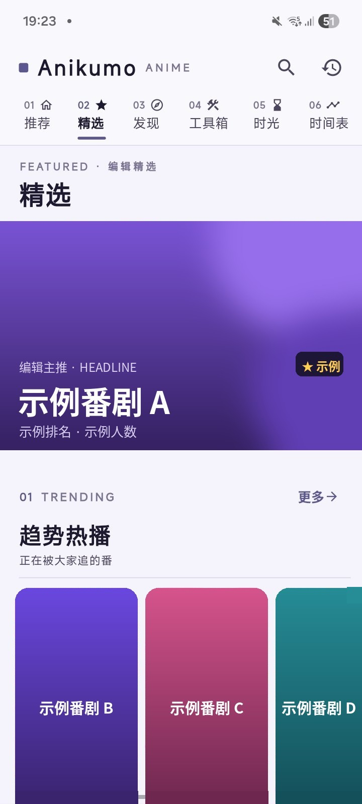
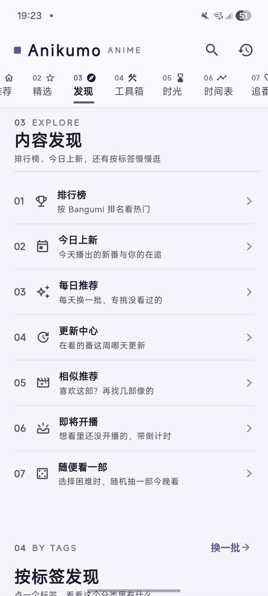
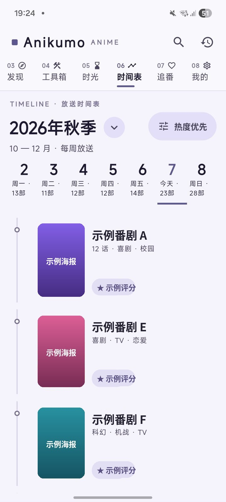
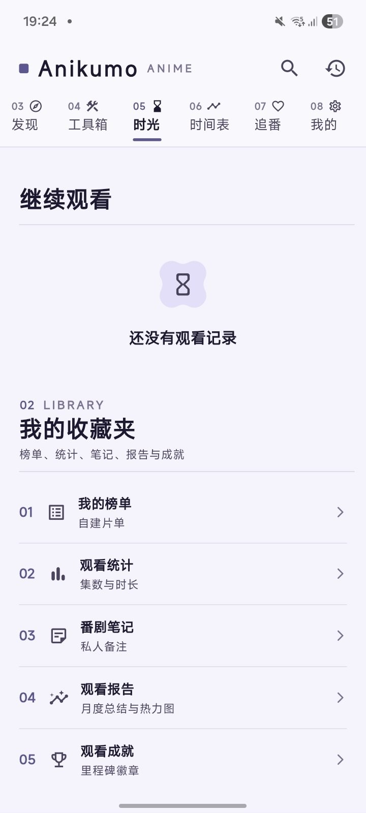
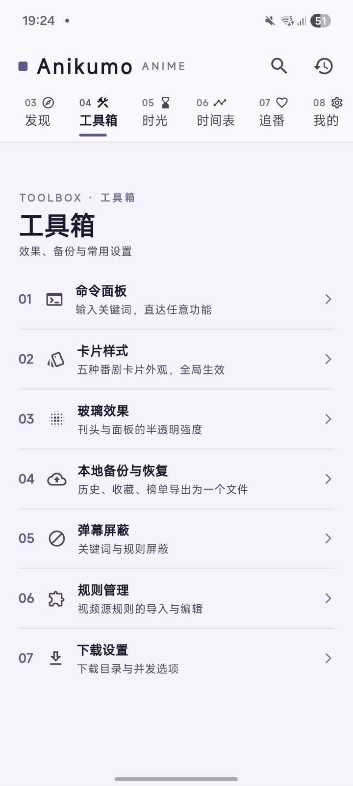
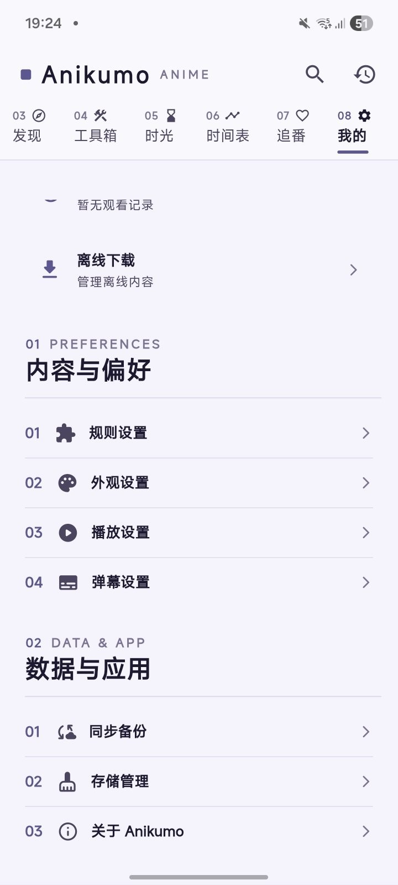

# Anikumo — 动漫、漫画、小说，一部 App 全装下

基于自定义规则的开源三合一应用：番剧信息与播放、JS 漫画源、Legado 小说书源，三大内容区彼此独立、又能跨区一搜即达。全自研界面：鸢尾紫 + 编辑部刊头风 + 悬浮胶囊导航。当前版本 2.4.3，主平台 Android（另有 Windows / macOS / Linux / iOS），开源免费、无广告、无内置片库。

- 官网：https://anikumo-brown.vercel.app/
- 下载：[GitHub Releases](https://github.com/xyu3032-commits/Anikumo/releases)
- 反馈：[GitHub Issues](https://github.com/xyu3032-commits/Anikumo/issues)
- 许可证：GPL-3.0

## 为什么用 Anikumo

1. **三合一**：动漫 + 漫画 + 小说，不用来回切 App
2. **规则驱动**：内容源全开放，自己导入、自己掌控
3. **快**：为几十个书源、几百话漫画做过专项性能治理
4. **干净**：无广告、无捆绑、数据归你（本地 + 自备 WebDAV）
5. **好看**：鸢尾紫编辑风、五种卡片、玻璃质感、深浅双主题

## 界面预览

> 截图中的作品名、海报与封面已做示例化处理（替换为渐变色块与「示例番剧 / 示例漫画」），不对应任何真实作品。

<table>
  <tr>
    <td align="center"> 精选</td>
    <td align="center"> 发现 · 专区入口</td>
    <td align="center"> 内容发现</td>
    <td align="center"> 放送时间表</td>
  </tr>
  <tr>
    <td align="center"> 时光</td>
    <td align="center"> 工具箱</td>
    <td align="center"> 我的</td>
    <td></td>
  </tr>
</table>

## 一、动漫区

- 番剧信息（Bangumi 数据）：每日放送时间表、排行榜与趋势榜、番剧详情（简介 / 评分 / 话数 / 角色声优 / 制作人员 / 关联条目 / 评论）
- 视频源规则：规则导入（直链 / 粘贴 / 文件）与可视化编辑、`anikumo://` 分享链接、多源并行搜索聚合、播放自动换源
- 播放器：弹弹play 弹幕（关键词 + 正则屏蔽、可同步）、Anime4K 实时超分、硬件解码与渲染器可选、Syncplay 异地一起看、外部播放器、后台播放、截图导出
- 追番与记录：收藏分组 + Bangumi 账号同步、观看历史时间线（时光）、断点续播、整话离线下载

## 二、漫画区（Violet Glass 设计）

- JS 漫画源：自定义导入三通道（直链 URL / 粘贴 JS / 本地文件）
- 多源同屏首页：每个源一节、自带分类横排（恋爱、后宫、热血……）；源置顶、失效源自动标记沉底
- 阅读器：条漫 / 分页双模式、横屏双页、相邻章节预加载、专用图片缓存（连看几十话不卡）、进度记忆
- 收藏追新「+N 话」徽标、逐话下载离线读、多源聚合搜索

## 三、小说区

- Legado 书源：兼容阅读 3.0 格式；导入支持订阅链接 / JSON / 本地文件
- 源多不卡：解析缓存 + 首页分节加载闸门；失效源自动打标、隐藏、折叠，两次确认才删；源置顶
- 阅读全链：站点压缩编码自适应解码、目录地址自动学习；「换源续读」——当前源读不了自动换同书其他源、按章节对齐续读
- 全源搜索（跳过失效源、单源超时封顶）、章节下载、进度记忆

## 四、跨区与通用

- 跨区统一搜索：全部 / 动漫 / 漫画 / 小说四段切换，一次看齐三区结果
- `anikumo://` 深链直达番剧、搜索与规则导入
- WebDAV 同步（历史、收藏、弹幕屏蔽规则跨设备，数据在你自己服务器）
- 本地备份与恢复：一个文件导出 / 还原历史、收藏、榜单
- 命令面板：输关键词直达任意功能
- 个性化：五种番剧卡片样式、玻璃强度、主题色与动态取色、定时深色、默认启动页、字体设置
- 低内存 / 流畅模式、PIN 应用锁、代理设置

## 文档

- [用户手册](docs/用户手册.md)——安装、频道总览、动漫 / 漫画 / 小说用法、跨区搜索、备份与 WebDAV、设置
- [免责手册](docs/免责手册.md)——要点速览 + 免责说明原文（与 App 首次启动显示的文本一致）

## 致谢

- **特别感谢 XpathSelector**：的项目是这款软件的最重要的组成部分。
- **特别感谢 Bangumi**：本项目使用了 Bangumi 开放 API 以提供番剧元数据。
- **特别感谢 Anime4K**：本项目使用 Anime4K 进行实时超分。
- **特别感谢 SyncPlay**：本项目使用 SyncPlay 协议并通过 SyncPlay 公共服务器实现一起看功能。
- **感谢 media-kit**：本项目跨平台媒体播放能力来自 media-kit。
- **感谢 avbuild**：本项目使用了来自 avbuild 的树外补丁实现非标准视频流播放。
- **感谢 hive**：本项目持久化储存能力来自 hive。

## 说明

- Anikumo 本身不提供任何内置片库，内容来自你自己导入的规则与源。
- 本仓库截图仅用于展示界面，作品名与海报均已示例化处理。
